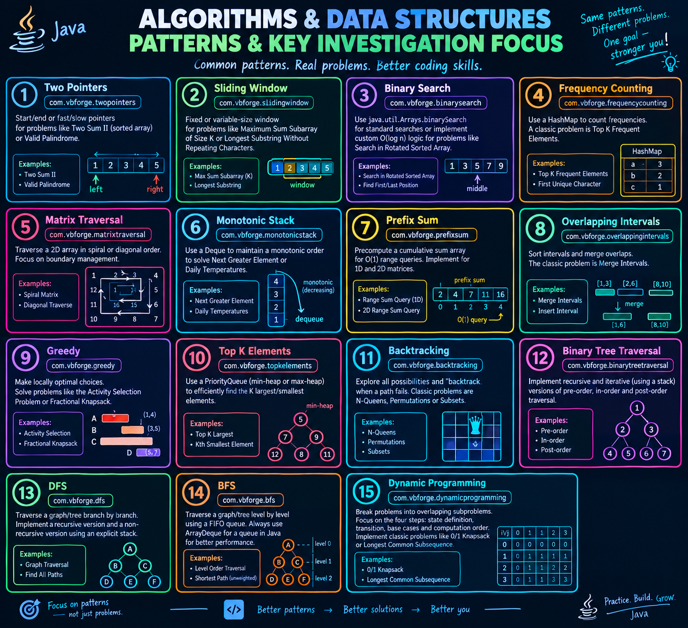

# DSA Patterns Investigation



---

## Development & Investigation

- > Systematic and high-quality implementation of all 15 patterns.
- [**SUMMARIZE DOCUMENTATION**](README-SUMMARIZE.md)  

1.  **Project Setup**: Maven, Java 21 (Records, Pattern Matching, Virtual Threads, Enhanced `switch`)

2.  **Package Structure**: source code in 15 packages (meaningful naming):
    *   `com.vbforge.twopointers`
    *   `com.vbforge.slidingwindow`
    *   `com.vbforge.binarysearch`
    *   `com.vbforge.frequencycounting`
    *   `com.vbforge.matrixtraversal`
    *   `com.vbforge.monotonicstack`
    *   `com.vbforge.prefixsum`
    *   `com.vbforge.overlappingintervals`
    *   `com.vbforge.greedy`
    *   `com.vbforge.topkelements`
    *   `com.vbforge.backtracking`
    *   `com.vbforge.binarytreetraversal`
    *   `com.vbforge.dfs`
    *   `com.vbforge.bfs`
    *   `com.vbforge.dynamicprogramming`

3.  **Investigation & Implementation Scope**

| Pattern                   | Package                            | Key Investigation Focus / Classic Problem                                                                                                                                                                                  |
|:--------------------------|:-----------------------------------|:---------------------------------------------------------------------------------------------------------------------------------------------------------------------------------------------------------------------------|
| **Two Pointers**          | `com.vbforge.twopointers`          | Start/end or fast/slow pointers for problems like **Two Sum II** (sorted array) or **Valid Palindrome**.                                                                                                                   |
| **Sliding Window**        | `com.vbforge.slidingwindow`        | Fixed or variable-size window for problems like **Maximum Sum Subarray of Size K** or **Longest Substring Without Repeating Characters**.                                                                                  |
| **Binary Search**         | `com.vbforge.binarysearch`         | Use `java.util.Arrays.binarySearch` for standard searches or implement custom `O(log n)` logic for problems like **Search in Rotated Sorted Array**.                                                                       |
| **Frequency Counting**    | `com.vbforge.frequencycounting`    | Use a `HashMap` to count frequencies. A classic problem is **Top K Frequent Elements**.                                                                                                                                    |
| **Matrix Traversal**      | `com.vbforge.matrixtraversal`      | Traverse a 2D array in spiral or diagonal order. Focus on boundary management.                                                                                                                                             |
| **Monotonic Stack**       | `com.vbforge.monotonicstack`       | Use a `Deque` to maintain a monotonic order to solve **Next Greater Element** or **Daily Temperatures**.                                                                                                                   |
| **Prefix Sum**            | `com.vbforge.prefixsum`            | Precompute a cumulative sum array for `O(1)` range queries. Implement for 1D and 2D matrices.                                                                                                                              |
| **Overlapping Intervals** | `com.vbforge.overlappingintervals` | Sort intervals and merge overlaps. The classic problem is **Merge Intervals**.                                                                                                                                             |
| **Greedy**                | `com.vbforge.greedy`               | Make locally optimal choices. Solve problems like the **Activity Selection Problem** or **Fractional Knapsack**.                                                                                                           |
| **Top K Elements**        | `com.vbforge.topkelements`         | Use a `PriorityQueue` (min-heap or max-heap) to efficiently find the K largest/smallest elements.                                                                                                                          |
| **Backtracking**          | `com.vbforge.backtracking`         | Explore all possibilities and "backtrack" when a path fails. Classic problems are **N-Queens**, **Permutations**, or **Subsets**.                                                                                          |
| **Binary Tree Traversal** | `com.vbforge.binarytreetraversal`  | Implement recursive and iterative (using a stack) versions of pre-order, in-order, and post-order traversal.                                                                                                               |
| **DFS**                   | `com.vbforge.dfs`                  | Traverse a graph/tree branch by branch. Implement a recursive version and a non-recursive version using an explicit stack.                                                                                                 |
| **BFS**                   | `com.vbforge.bfs`                  | Traverse a graph/tree level by level using a FIFO queue. **Always use `ArrayDeque`** for a queue in Java for better performance.                                                                                           |
| **Dynamic Programming**   | `com.vbforge.dynamicprogramming`   | Break problems into overlapping subproblems. Focus on the four steps: state definition, transition, base cases, and computation order. Implement classic problems like **0/1 Knapsack** or **Longest Common Subsequence**. |

---

## Java 21-Specific Implementation Strategy

> implementation by modern Java 21 following:

*   **Records for Immutable Data**: For problems involving intervals, points, or tuples, `record` to create clean, immutable data carriers. For example:
    ```java
    public record Interval(int start, int end) {}
    ```
*   **Leverage `ArrayDeque`**: For implementing stacks (in **Monotonic Stack**, **DFS**, **Binary Tree Traversal**) and queues (in **BFS**), `ArrayDeque` is generally faster and more memory-efficient than `LinkedList` or `Stack`.
*   **Embrace `Stream` API**: For problems like **Frequency Counting** or **Top K Elements**, Java Streams can provide elegant solutions. For example, counting frequencies:
    ```java
    Map<Integer, Long> frequencyMap = Arrays.stream(nums)
        .boxed()
        .collect(Collectors.groupingBy(Function.identity(), Collectors.counting()));
    ```
*   **Implement Unit Tests**: For each pattern, test cases using **JUnit 5** to verify correctness, including edge cases (empty input, single element, duplicates, etc.).

---

## Verification and Documentation

1.  **Tests**: Execution unit tests to ensure all implementations are correct.
2.  **Document Complexity**: For each implemented algorithm, added Javadoc comments detailing the **Time Complexity** and **Space Complexity**.
3.  **README-SUMMARIZE.md**: Summarized the patterns, their key use-cases, and the problem each package solves.

---
