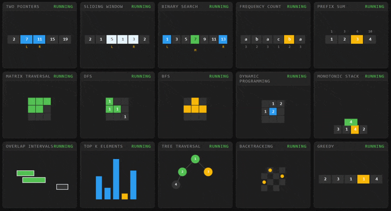

# DSA Patterns - Visual

An interactive, zero-dependency (almost) web application that visualizes 15 fundamental Data Structures & Algorithms patterns step-by-step.

Built with **Java 21** (JDK `HttpServer`), **Vanilla JavaScript**, and **HTML5 Canvas** — no Spring Boot, no React, no heavy frameworks. Just pure algorithmic visualization.



## ✨ Features

- **15 Core Patterns**: Covering everything from Two Pointers to Dynamic Programming.
- **7 Dynamic Renderers**: Specialized canvas rendering for arrays, grids, trees, intervals, heaps, and recursion paths.
- **Interactive Playback Engine**: Play, Pause, Step Forward, Step Backward, Scrub to any frame, and adjust playback speed.
- **Clean Architecture**: A minimal `Frame` protocol transmits state from the Java backend to the JS frontend via batch JSON.

## 🚀 Quick Start

### Option 1: Run with Docker (Recommended)
The fastest way to run the visualizer. No Java or Maven installation required.

```bash
docker build -t dsa-visual-simple .
docker run -p 8080:8080 dsa-visual-simple
```
Open [http://localhost:8080](http://localhost:8080) in your browser.

### Option 2: Run Natively
You need **JDK 21** and **Maven** installed.

```bash
mvn clean package
java -jar target/dsa-visual-simple.jar
```
Open [http://localhost:8080](http://localhost:8080) in your browser.

## 🧠 Architecture

This project uses a simple but powerful state-machine architecture:

1. **The Backend (`PatternRunner`)**: Runs the algorithm step-by-step. At every meaningful state change, it emits a `Frame` record containing:
    - `renderer`: A string identifying which JS drawing function to use.
    - `data`: A key-value map of the current visual state (arrays, pointers, colors, etc.).
    - `note`: A one-line explanation of what just happened.
2. **The API (`/trace?pattern=X`)**: Serializes the list of frames to a JSON array.
3. **The Frontend (`app.js`)**: Fetches the array, passes individual frames to the appropriate renderer, and manages the playback state (Play/Pause/Scrub).

## 📚 Supported Patterns

| Pattern | Renderer | Algorithm Visualized |
| :--- | :--- | :--- |
| **Two Pointers** | `array+pointers` | Two Sum II (Sorted Array) |
| **Sliding Window** | `array+pointers` | Max Sum Subarray of Size K |
| **Binary Search** | `array+pointers` | Classic target search |
| **Frequency Counting** | `array+pointers` | First Unique Character |
| **Prefix Sum** | `array+pointers` | Range Sum Query |
| **Matrix Traversal** | `grid` | Spiral Matrix |
| **DFS** | `grid` | Number of Islands |
| **BFS** | `grid` | Rotting Oranges |
| **Dynamic Programming** | `grid` | Edit Distance |
| **Monotonic Stack** | `stack` | Daily Temperatures |
| **Overlapping Intervals** | `intervals` | Merge Intervals |
| **Top K Elements** | `heap` | Top K Frequent Elements |
| **Binary Tree Traversal** | `tree` | Pre-order Traversal |
| **Backtracking** | `path` | N-Queens |
| **Greedy** | `array+pointers` | Jump Game II |

## 🧪 Testing

Run the integration tests to verify backend logic and renderer payloads:

```bash
mvn test
```

## 🛠️ Built With

- **Java 21** (Records, enhanced switch, standard HttpServer)
- **Gson** (JSON serialization)
- **HTML5 Canvas & Vanilla JS** (Client-side rendering)
- **JUnit 5** (Backend testing)