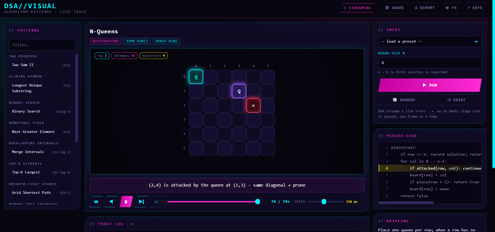

# DSA PATTERNS VISUAL

Live, interactive visualizations of classic algorithm patterns. A tiny Java server
(JDK `HttpServer` + Gson, **no framework**) runs each algorithm and **streams its
execution over Server-Sent Events**; a vanilla-JS canvas UI plays it back with
pause / step / scrub. Cyberpunk skin: neon on near-black.



```
mvn clean package
java -jar target/dsa-visual.jar          # → http://localhost:8080
```

`target/lib/` must stay next to the jar (the manifest classpath points at it).
Options: `--port 9090`, `--host 0.0.0.0` (default is loopback only), or `PORT` / `HOST` env vars.
Requires JDK 21.

## What you can visualize

| Pattern | Algorithm | Renderer |
|---|---|---|
| Two Pointers | Two Sum II | array |
| Sliding Window | Longest substring without repeats | array |
| Binary Search | Closed-interval search (+ insertion point) | array |
| Monotonic Stack | Next Greater Element | stack |
| Overlapping Intervals | Merge Intervals | intervals |
| Top-K Elements | k largest via min-heap (every sift shown) | heap |
| Breadth-First Search | Grid shortest path, 4/8 moves, paintable maze | grid |
| Binary Tree Traversal | Pre / In / Post (iterative, stack visible) and Level-order | tree |
| Dynamic Programming | Longest Common Subsequence (table + backtrack) | grid |
| Backtracking | N-Queens (prune / choose / un-choose) | grid |

**Nothing is hard-coded.** Every algorithm declares its inputs (`Meta.Field`) and the UI builds the
form from that schema: number lists, strings, interval pairs, level-order trees (`1,2,3,null,6`),
a click-and-drag **maze editor**, selects. Each has presets, a 🎲 *Random* generator and validation
(client-side *and* server-side, with friendly messages).

## Interaction model

* **RUN** opens an SSE stream; frames render as the server computes them.
* **Pause pauses the computation itself** – the server blocks inside the trace before producing the
  next frame. **Step ▶** releases exactly one more frame. Speed changes apply instantly mid-run.
* **Step back / scrub / log-click** move through every frame received so far (and pause the live trace).
  **Play** replays the buffer, then — if the trace is still alive — hands control back to the server.
* After completion the whole trace is buffered: replay, scrub and **Export** (JSON) work offline.
* **Share** copies a deep link that restores the algorithm *and* its input.
* Pseudo-code panel highlights the line each frame executes; trace log lists every step.
* Keys: `Space` play/pause · `←` `→` step · `Home` `End` · `+` `-` speed · `R` run · `?` help.

## API

```
GET  /api/catalog                                 algorithms + input schemas + presets
GET  /api/health                                  status, version, uptime, live sessions
GET  /api/stream?algo=&params=<json>&delay=&mode=play|step      text/event-stream
POST /api/control?session=&cmd=pause|resume|step|stop|delay[&value=ms]
```

SSE events: `session {id}` · `frame {renderer,data,note,line}` · `done {frames,ms,truncated,stopped}` ·
`fail {message}` (all errors arrive as `fail`, because `EventSource` can't read HTTP error bodies).

Safety rails: ≤ 32 concurrent traces, ≤ 6 000 frames per trace, input bounds on every field, a 15 s
heartbeat that reclaims sessions whose client vanished while paused, 15 min idle timeout, whitelisted
static paths, CSP and `nosniff` headers. Requests run on virtual threads and sessions use
`ReentrantLock`/`Condition` so parked traces never pin a carrier thread.

## Adding an algorithm (≈ 60 lines)

1. Implement `Algorithm` in `com.vbforge.visual.patterns`:

```java
public final class MyTrace implements Algorithm {
    public Meta meta() { return new Meta("my-id", "Name", "Pattern", blurb, time, space, insight,
            pseudoLines, List.of(Field.intList("nums", ...)), List.of(Preset.of("Demo", "nums", new int[]{...}))); }

    public void trace(Params p, Consumer<Frame> emit) {
        int[] nums = p.ints("nums", 1, 24, -99, 99);        // validated; throws a user-facing message
        emit.accept(Frame.of("array", Data.of().with("values", nums).with("marks", "..c."), "note", /*pseudo line*/ 2));
    }
}
```

2. `register(new MyTrace())` in `PatternRunner`. The sidebar, form, presets, random generator,
   pseudo-code and playback appear automatically. `emit.accept` may block or throw to cancel – don't
   catch `RuntimeException` around it.
3. Need a new picture? Add a function to `web/js/renderers.js` (schemas are documented above each one).

Renderer payloads — `array`: `values, marks, pointers, window, info, lists` ·
`stack`: `values, cur, stack, result, marks` · `intervals`: `items[{s,e,st}], merged` ·
`heap`: `values, cur, heap, k, marks` · `grid`: `rows, cols, cells, nums|text, rowLabels, colLabels, checker` ·
`tree`: `tree{v,l,r}, marks`. All accept `info` (chips) and `lists` (labelled rows).

## Layout

```
src/main/java/com/vbforge/visual/
  Main · Api (SSE/JSON) · TraceSession (pause/step gate) · StaticHandler · Http
  Frame · Data · Viz · Meta · Params · Algorithm · PatternRunner
  patterns/   one class per algorithm
src/main/resources/web/
  index.html · style.css · app.js (controller) · js/{api,inputs,renderers}.js
```
